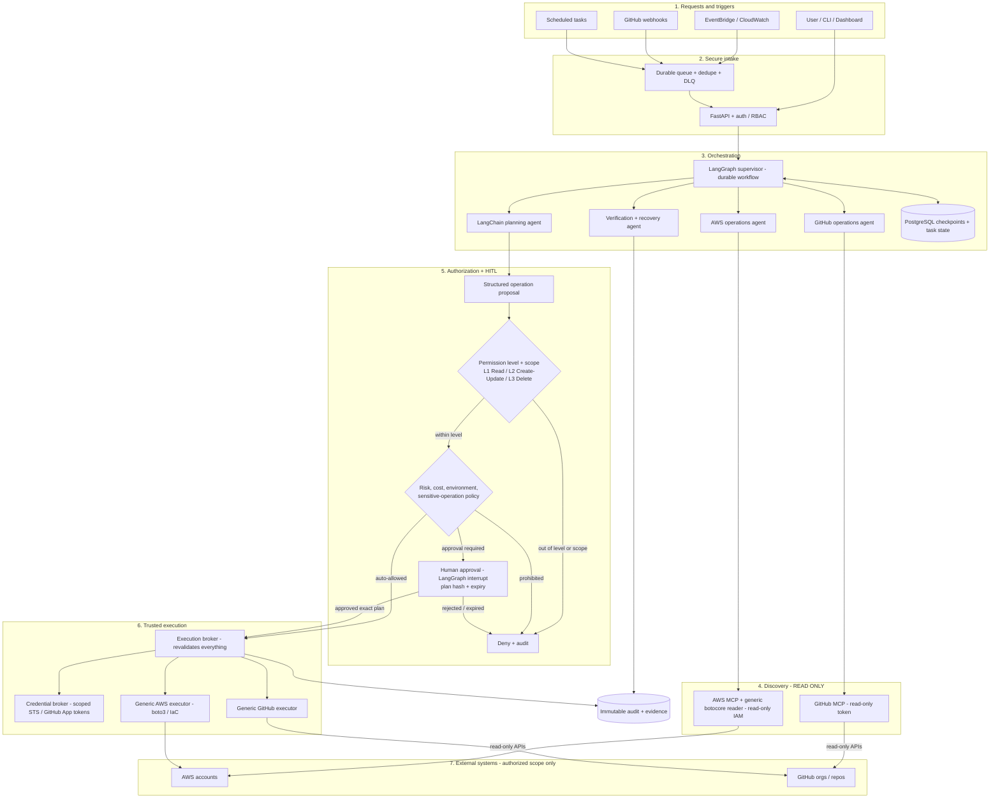

# Mini-Agent: autonomous AWS + GitHub operations platform

A general-purpose, policy-enforced agent platform that discovers, investigates, plans and (in later phases) executes authorized operations across the AWS and GitHub API surfaces, with deterministic authorization, risk-based human approval, verification and audit.

**Status:** the full platform is implemented and tested with stubbed AWS/GitHub and a real PostgreSQL: Deep Agents planner, generic AWS (botocore) and GitHub (REST) read/write layers, policy engine with L1/L2/L3 permission levels, gated execution brokers, durable approvals with LangGraph `interrupt()`, Postgres checkpoints and work queue, webhooks and EventBridge triggers, an authenticated API, a kill switch, and an AgentCore entrypoint. **Writes are off by default and nothing has been run against a live AWS account, Bedrock or GitHub yet.** Follow "Live validation" in [`docs/IMPLEMENTATION_PLAN.md`](docs/IMPLEMENTATION_PLAN.md) in a sandbox before enabling any write class.

## Architecture



Rules the code enforces today:

- The LLM never holds write credentials. Every AWS call goes through a botocore guard that allows only READ-classified operations, and live reads require an identity proven read-only by IAM policy simulation.
- Any AWS service/operation is discovered from botocore models (436 services, ~19.5k operations); none are hand-coded. ECS diagnosis is an example playbook only.
- Tool output and AWS/GitHub content are redacted and treated as untrusted data.

## Quick start

Requires [uv](https://docs.astral.sh/uv/). Python 3.12 is pinned and installed by uv.

```bash
uv sync
cp config/agent.example.toml config/agent.toml   # edit accounts, regions, model id
uv run infra-agent validate-config
```

### Offline demo (no AWS, no Bedrock)

```bash
uv run infra-agent investigate --account dev --region ap-south-1 --cluster dev-cluster \
  --mock --github-fixture --repo example-org/backend --no-llm
```

### Explore the AWS API surface (offline)

```bash
uv run infra-agent discover                       # all services
uv run infra-agent discover --service rds         # READ operations
uv run infra-agent discover --service rds --all   # with WRITE / DELETE / SENSITIVE_READ classes
```

### Live read-only use

1. Create a dedicated **read-only** role (e.g. `ReadOnlyAccess` + `iam:GetRole` and `iam:SimulatePrincipalPolicy` on itself, with explicit denies for secret reads) and an SSO profile for it. Never use admin credentials.
2. Put the profile name and account ID in `config/agent.toml`.
3. Opt in and validate:

```bash
aws sso login --profile infra-agent-readonly-dev
export INFRA_AGENT_LIVE_READS=true
uv run infra-agent check-credentials --account dev   # fails unless probe mutations are denied
uv run infra-agent read --account dev --region ap-south-1 --service ec2 --operation DescribeInstances
uv run infra-agent investigate --account dev --region ap-south-1 --cluster <cluster> --out reports/r.md
uv run infra-agent investigate ... --agent --question "why is the api service unhealthy?"
```

`--agent` runs a LangChain `create_agent` loop on Bedrock with the AWS MCP knowledge/script tools (read-only identity) plus the generic `aws_read` tool.

### Running the autonomous platform

```bash
export INFRA_AGENT_DATABASE_URL=postgresql://infra_agent@localhost:5432/infra_agent
uv run infra-agent migrate
uv run infra-agent hash-token                        # API token + sha256 for config [[api.users]]
uv run uvicorn infra_agent.api.main:app --port 8080  # API: tasks, approvals, webhooks, kill switch
uv run infra-agent worker                            # plans, approval pauses, execution, verification
uv run infra-agent events                            # optional: EventBridge -> SQS triggers
```

Typical flow:

1. `POST /v1/tasks` with `{"intent": "...", "account_alias": "dev", "region": "ap-south-1"}` (operator token).
2. The worker plans with a Deep Agent (read-only tools + AWS MCP). The policy engine checks every step. Read-only and auto-allowed steps run; anything else pauses.
3. `GET /v1/approvals` and `GET /v1/approvals/{id}` show the exact plan and digest. `POST /v1/approvals/{id}/decision` with `{"decision": "approve", "plan_digest": "..."}` (approver token, not the requester).
4. The worker resumes from the Postgres checkpoint, the broker re-checks everything and executes, and the verifier reads state back. Check `GET /v1/tasks/{id}` and `GET /v1/tasks/{id}/events`.
5. Emergency: `POST /v1/admin/kill-switch {"frozen": true}` blocks every write immediately.

Writes need all of: `[execution] aws_writes_enabled = true`, `INFRA_AGENT_ENABLE_AWS_WRITES=true`, the account's `writes_enabled` + `execution_profile` + `permission_level >= 2`, a policy decision, and a consumed approval when required. Deploy IAM from `infra/cloudformation/infra-agent.json`.

Container / AgentCore: `docker buildx build --platform linux/arm64 -t infra-agent .` (default command serves the AgentCore `/ping` + `/invocations` contract).

## Development

```bash
uv run pytest          # offline; no AWS credentials used
uv run ruff check . && uv run ruff format --check .
uv run mypy            # strict
```

CI (`.github/workflows/ci.yml`) runs the same plus a gitleaks secret scan.

## Source layout

```text
src/infra_agent/
  config.py              operator TOML + env settings (writes locked off by type)
  core/                  provider-neutral OperationRef/Request/Result, AccessClass, permission levels
  aws/                   botocore catalog, access classifier, generic read executor, fixtures
  security/              read guard, credential validation, redaction
  execution/             AWS execution broker, read-back verifier
  github/                GitHub classifier, REST reader, App tokens, write broker
  policy/                deterministic policy engine (levels, prohibitions, risk)
  approval/              human approval decisions
  persistence/           Postgres store, migrations, work queue
  events/                webhook/EventBridge validation, triggers, SQS poller
  integrations/          Bedrock, AWS MCP adapter, GitHub fixture source
  agents/                Deep Agents planner, generic AWS/GitHub read tools
  graph/                 operations workflow (HITL) + investigation workflow
  runtime.py             platform wiring and worker
  agentcore_app.py       AgentCore Runtime entrypoint
  playbooks/ecs_health/  example playbook: ECS diagnosis + GitHub Actions correlation
  api/                   FastAPI (auth, tasks, approvals, webhooks, admin)
  cli.py                 infra-agent CLI
tests/                   unit / integration / adversarial
infra/cloudformation/    IAM roles, permission boundary, event intake
```

## Documentation

| File | Purpose |
|---|---|
| `AGENTS.md` | Binding instructions for coding agents |
| `docs/PRODUCT_REQUIREMENTS.md` | Universal scope, scenarios, acceptance |
| `docs/ARCHITECTURE.md` | Components, generic operation model, failure design |
| `docs/SECURITY_AND_POLICY.md` | Permission levels, risk tiers, IAM, bypass prevention |
| `docs/HUMAN_IN_THE_LOOP.md` | Approval state machine and resume rules |
| `docs/IMPLEMENTATION_PLAN.md` | 7 phases with status and exit criteria |
| `docs/DECISIONS_AND_REFERENCES.md` | ADRs and upstream references |
| `docs/aws-github-infra-agent/` | Extended reference spec pack (ECS-first; superseded on scope by the files above) |
