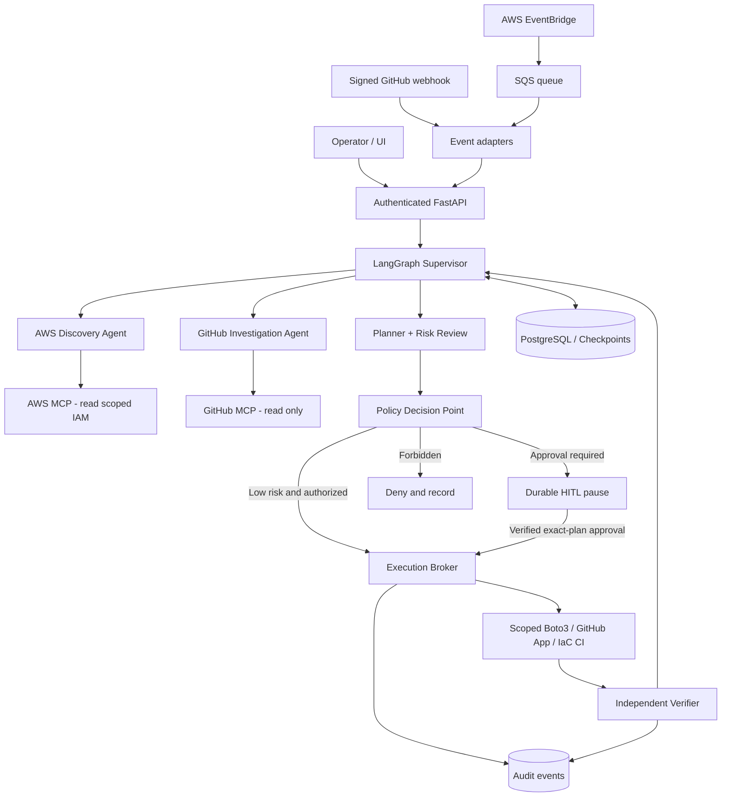

# System Architecture

## Architectural rule

**Agents reason; trusted services authorize and execute.** A system prompt or middleware message is not a security boundary. The LLM does not hold unrestricted AWS credentials or directly choose which privileged role to assume.

## Logical components

1. **API + approval UI** (FastAPI; any UI later): authentication, task submission, timeline, approval and cancellation.
2. **Event adapters:** GitHub signed webhook verifier, EventBridge -> SQS, deduplication, event classifier.
3. **LangGraph supervisor:** long-lived task state, decomposition, routing, retry/stop conditions, HITL interrupt, result synthesis.
4. **Specialized agents:** AWS Discovery (read-only), GitHub Investigation (read-only), Planner, Change Reviewer, Verifier. These are graph nodes or subgraphs, not separately trusted principals.
5. **AWS MCP discovery adapter:** docs/skills + read-only operations under read-scoped credentials. **The managed `aws___run_script` tool can call AWS APIs; IAM must ensure this connection cannot mutate.**
6. **GitHub MCP read adapter:** official GitHub MCP in read-only mode with limited repo access.
7. **Policy decision point (PDP):** deterministic rules, risk classifier, account/resource allowlists, budget ceiling, approval requirement and explicit denials.
8. **Execution broker (PEP):** only place allowed to execute writes; checks exact plan digest, human approval, target, operation, resource, freshness, idempotency, and role before forwarding request.
9. **Cloud connectors:** Boto3/botocore operation gateway; GitHub App write gateway; optionally GitHub Actions for IaC workflows.
10. **Persistence:** PostgreSQL for task/event/approval/audit records and LangGraph checkpointer; object storage for large redacted artifacts.
11. **Operations:** structured logs, metrics, tracing, CloudWatch/CloudTrail correlation, alerts, dead-letter queue.

## Diagram



## Proposed LangGraph state machine

```text
RECEIVED
  -> TRIAGE
  -> DISCOVER_AWS / DISCOVER_GITHUB
  -> BUILD_PLAN
  -> NORMALIZE_AND_FINGERPRINT_PLAN
  -> EVALUATE_POLICY
        -> DENIED -> END
        -> AWAITING_APPROVAL -> APPROVED/REJECTED/EXPIRED
        -> AUTO_AUTHORIZED
  -> REVALIDATE_AT_EXECUTION
  -> EXECUTE_ONE_STEP
  -> VERIFY_STEP
        -> NEXT_STEP -> REVALIDATE_AT_EXECUTION
        -> RETRY_WITH_BACKOFF (only when safe)
        -> FAILED / NEEDS_REVIEW
  -> VERIFY_OVERALL_OUTCOME
  -> COMPLETED / PARTIALLY_COMPLETED / FAILED
```

Every graph edge that may execute a write must go through the broker. Approvals are checked **for every authorized step**, not assumed to apply indefinitely after the first step.

## Long-running execution

- Persist workflow state at every significant step. Use a durable checkpointer and a stable `thread_id` per task.
- An `interrupt()` must be in a node without earlier non-idempotent side effects because the node re-executes from the start on resume.
- Queue workers own execution leases. Lease expiry may cause retries; deduplication + reconciliation protect against duplicate mutations.
- External API timeouts can have ambiguous outcomes: query the actual AWS/GitHub resource before retrying.
- Separate scheduling from graph execution. Webhooks should acknowledge promptly and enqueue work rather than running the agent inline.

## Multi-step operations

For a request like "deploy service from GitHub to private subnet behind ALB", create a dependency graph and prefer a Terraform/CloudFormation plan + PR + protected CI deployment. Avoid uncoordinated direct API sequences with no rollback boundaries.

For a narrow operation (e.g., force deployment of one tagged development ECS service), a direct structured API call can be appropriate when policy allows it.

## AgentCore vs persistence

AgentCore Runtime is the deployment environment, not a substitute for application-level authorization, task-state integrity, workflow checkpoints, idempotency, or approval records. Plan how state persists across isolated runtime invocations and scale-out workers.

## Failure design

- MCP unavailable: report partial discovery and retry boundedly; do not guess state.
- Role assumption denied: stop and report IAM failure; never fall back to a broader role.
- Approval expired: no execution; re-plan and require fresh approval.
- Planned resource drift: invalidate approval and re-evaluate.
- Partial deployment: mark `PARTIALLY_COMPLETED`, retain evidence, offer a recovery plan; never claim automatic rollback succeeded unless verified.
