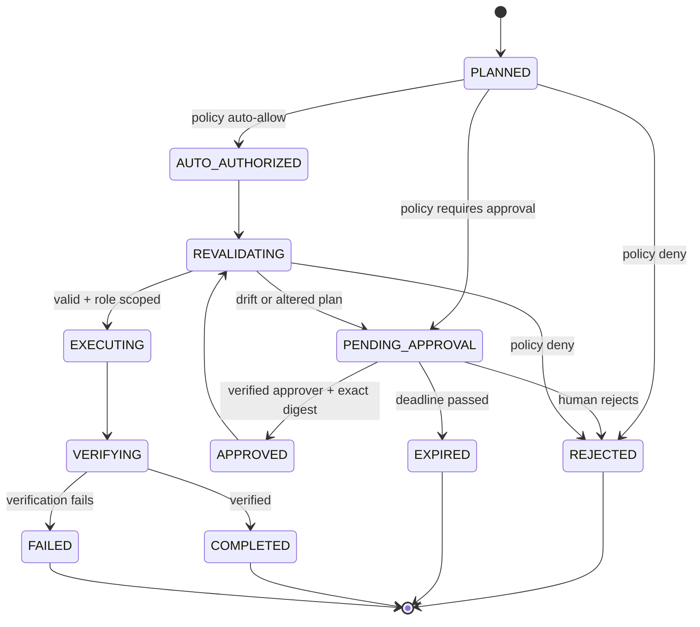

# Human in the Loop (HITL)

## Principle

Human approval is **risk-based**, not a confirmation before every tool call. Investigation remains largely autonomous; high-impact changes are paused. Human approval does not replace IAM restrictions or automated policy enforcement.

## States



## Approval request must include

- Task ID and operator-visible plain-language summary.
- Proposed exact actions, AWS service/API, account alias, region, resource ARNs/tags, GitHub repo/branch.
- Plan diff (IaC or structured action parameters), assumptions and observed evidence.
- Risk, data-loss/reversibility assessment, potential public exposure, cost estimate and uncertainty.
- Verification method, fallback/manual recovery actions, and expiration.
- Canonical cryptographic digest of the immutable plan; one-time approval ID; requester and qualified approver.

## Durable LangGraph implementation

Implement an approval node using the official LangGraph `interrupt()` primitive with persistent checkpointing and resume via `Command(resume=...)` and the same thread ID. **Do not execute mutating side effects before the interrupt within that node**, because LangGraph may execute the node from its beginning on resume.

Pseudocode (do not run as a complete implementation):

```python
from langgraph.types import interrupt

def await_approval(state):
    decision = interrupt({
        "approval_id": state["approval_id"],
        "plan_digest": state["plan_digest"],
        "summary": state["approval_summary"],
    })
    # Server-side verification belongs in approval service and broker;
    # this returned value alone is NOT authorization.
    return {"approval_response": decision}
```

The HTTP approval endpoint authenticates the actual approver and writes the approval decision to persistent storage. A trusted orchestration service resumes the graph; the executor still verifies the approval record independently.

## Authorization checks on resume

1. Approval ID exists and is unused, not expired, not revoked.
2. Approver has authority for the environment/operation and is not prohibited by separation-of-duties rules.
3. Task ID, plan digest, account, region, resources and operation bounds match.
4. Policy/permissions have not changed into a more restrictive state; resources have not drifted from assumptions.
5. Token is consumed atomically / replay is prevented and execution lease is acquired.
6. The action is still within budgets and allowed execution window.

## Approve, reject, request changes

- **Approve:** authorize only the exact frozen plan, no alternative steps.
- **Reject:** mark terminal or return to planner without execution.
- **Request changes:** modify proposal, generate a new digest and approval request; prior approval invalidated.
- **Expired:** no action; force re-plan and approval.
- **Cancel task:** stop future steps; cannot undo already executed calls. Report partial state.

## Example API sequence

```text
POST /v1/tasks            -> 202 task_id
GET /v1/tasks/{id}       -> status: AWAITING_APPROVAL
GET /v1/approvals/{id}   -> exact plan and risk summary
POST /v1/approvals/{id}/decision  {"decision":"approve","plan_digest":"..."}
GET /v1/tasks/{id}       -> EXECUTING -> VERIFYING -> COMPLETED
```

## Acceptance tests

- A pending task survives a service restart and resumes exactly once.
- Approval on a different plan hash fails; expiry and duplicate approval fail.
- Approval never expands resource, account or region scope.
- The graph refuses to execute when the approval service is unavailable.
- No side effect is repeated if `interrupt()` resumes a node.
