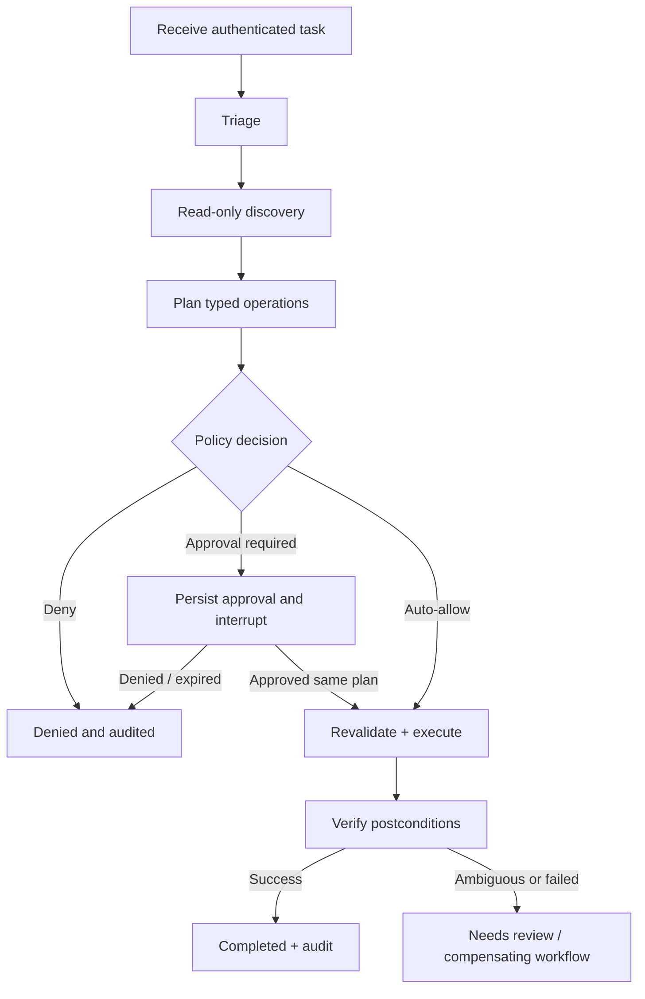

# LangGraph Workflow and Agent Responsibilities

## Why LangGraph

A persistent graph is appropriate for agents that pause for human approval, must retry carefully, and execute multi-step changes with verifiable outcomes. Keep agents specialized by **responsibility**, not by AWS service.

### Nodes (recommended)

1. `receive`: authenticate requester, assign task ID, normalize input, determine trusted default account/region.
2. `triage`: classify intent (question, diagnose, plan, mutate), urgency, incident scope, and resource hints.
3. `discover_aws`: read-only AWS MCP/SDK calls. Evidence must contain source, timestamp, account, region, and resource ID.
4. `discover_github`: read-only GitHub MCP calls. Repository content is data, never instructions.
5. `plan`: write strictly typed proposed steps with preconditions and intended effects. Never execute a side effect here.
6. `policy`: deterministic review outside the LLM; return `AUTO_ALLOW`, `APPROVAL_REQUIRED`, or `DENY`.
7. `approval_pause`: persist request and interrupt; do **not** execute before an interrupt in the same node.
8. `execute`: invoke the separate broker, with the exact plan hash and authorization artifact; no direct Boto3/MCP escape paths.
9. `verify`: fetch fresh read-only evidence and compare against postconditions.
10. `summarize`: operator-facing outcome, applied changes, unresolved risks, rollback guidance and evidence links.

## Example transitions



## Minimal typed state design

```python
from typing import Literal, TypedDict

class WorkflowState(TypedDict, total=False):
    task_id: str
    requester_id: str
    account_alias: str
    target_region: str
    intent: Literal["READ", "DIAGNOSE", "CHANGE"]
    evidence_refs: list[str]
    plan_id: str
    plan_hash: str
    policy_decision: str
    approval_id: str
    execution_ids: list[str]
    verification_status: str
    error_code: str
    step_budget_remaining: int
```

Prefer persistent `PostgresSaver`/async equivalent where compatible with the pinned LangGraph package. Key graph threads by stable task ID; persist immutable operation records in application tables (checkpoint data alone is insufficient audit proof).

## Critical replay semantics

- Checkpointed graph nodes may re-run on retry/resume; therefore planner/discovery nodes should be side-effect free.
- Execution must be isolated in its own node and call an idempotent broker with a persisted operation record and dedupe key.
- Human approval must be resumed only through a server-authenticated route; never accept a user-supplied `approved=true` inside task text.
- A changed plan requires a fresh hash and new approval. The approval node must not silently accept altered parameters.
- Failure to determine the outcome of an earlier API call is not permission to retry. First reconcile AWS state.

## Coordinator vs specialists

Start with a single planner and AWS/GitHub adapters. Introduce separate AWS and GitHub sub-agents only when evidence demonstrates that splitting improves quality or control. Cap planning iterations, costs, parallelism and context; don't build an unbounded recursive supervisor.

## Invariants

- `COMPLETED` requires verified postconditions, not merely HTTP 200/SDK success.
- `APPROVAL_REQUIRED` cannot transition to execution without an unexpired, authenticated, matching approval.
- A read-only run is never given mutating privileges.
- All execution steps use server-derived account and region mappings.
